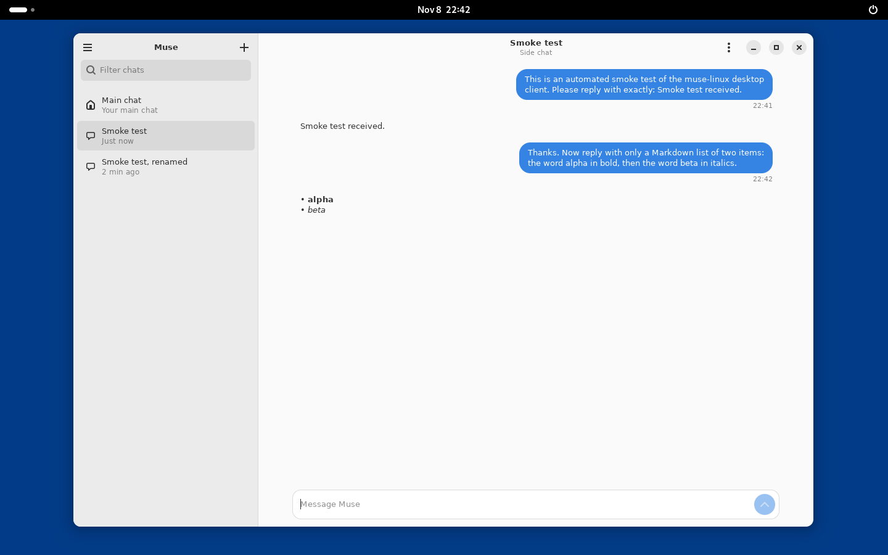
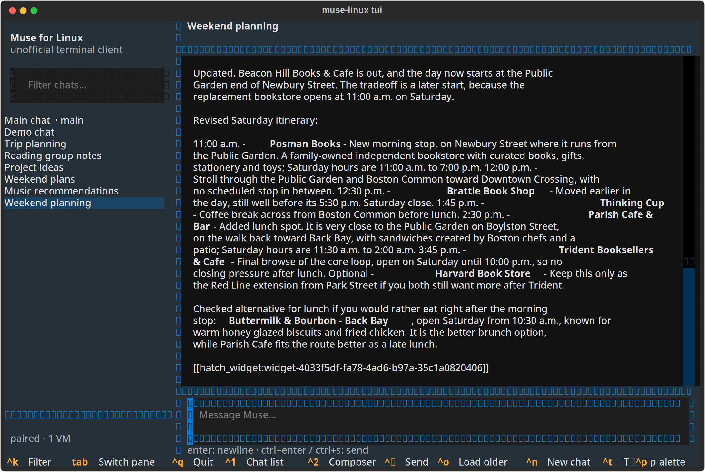
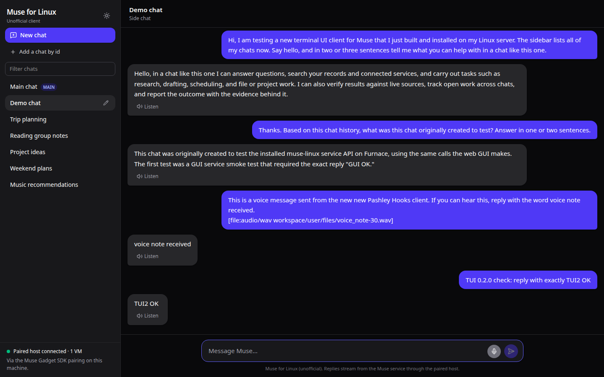
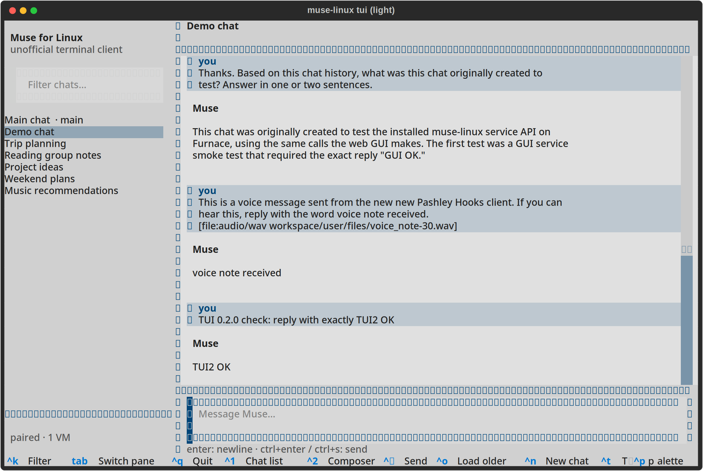
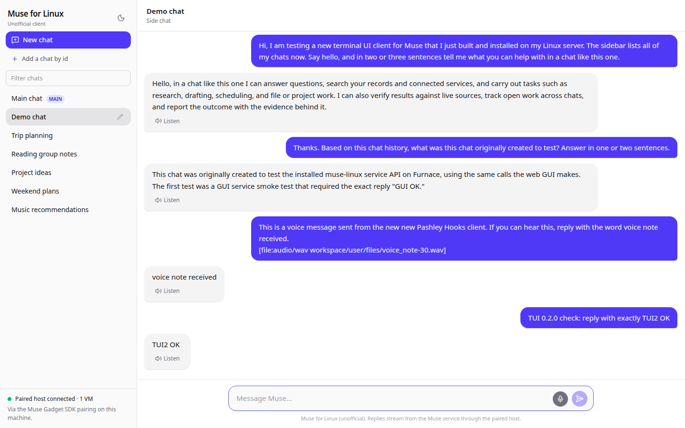

# muse-linux

An unofficial Linux client for Meta Muse, built on the
[Muse Gadget SDK](https://github.com/facebookincubator/muse-gadget-sdk).

> **Unofficial.** This is a community project. It is not made by,
> endorsed by, or affiliated with Meta. "Muse" is used only to describe
> what the software talks to. You need a Muse account and a Linux
> machine paired as a Muse gadget (see Quickstart).

The Muse apps exist for Mac, iOS and the web. This project is the
missing Linux piece: a native GNOME desktop app, a full-screen
terminal UI, a web GUI, a line-mode client, and an OpenAI-compatible
shim that lets existing
chat front ends talk to Muse, all over one small Python library
(`muselinux`) that speaks to your actual Muse: the main chat and
side chats by their real session ids, canonical history, streaming
replies, live working status, voice notes and spoken replies.

## Screenshots

The GNOME desktop app, during the recorded live smoke test (more in
[docs/GNOME.md](docs/GNOME.md)):



The terminal UI (dark theme), against a demo chat index:



The web GUI (dark theme):



Light themes are built into both (the TUI toggles with ctrl+t, the
web GUI with its theme button):





## What it does

- **A GNOME desktop app**, "Muse for Linux" (GTK 4 + libadwaita): your
  chats in a sidebar, streaming replies with Markdown, live working
  status, side chats, history, view-only approvals and desktop
  notifications. See [docs/GNOME.md](docs/GNOME.md). A KDE Plasma
  client on the same daemon comes next.
- **Chat in the terminal** with your actual Muse: the main chat and
  side chats addressed by their real session ids, with streaming
  replies and live working status. `muse-linux tui` gives a
  full-screen terminal UI in the Muse app's layout (chat sidebar
  with a filter, multiline composer, streaming Markdown replies,
  working status, light and dark themes); `muse-linux chat` is the
  plain line-mode client.
- **Chat in the browser**: `muse-linux serve` runs a native API
  plus a web GUI with the Muse-specific surface intact (working
  status, task state, approval snapshots, voice). See
  [gui/README.md](gui/README.md); deploy/install.sh installs it as
  a systemd service.
- **History**: read a chat's canonical transcript, up to the
  measured 200-message server window, with load-older controls.
- **Voice**: send voice notes and hear replies spoken (TTS), in
  the CLI and the web GUI.
- **Side chats**: create new ones, keep a local index of the chats you
  use, rename them locally.
- **A local OpenAI-compatible shim** (`/v1/models`,
  `/v1/chat/completions`, streaming included) so front ends such as
  Jan, LibreChat or Open WebUI can use Muse as their backend with no
  code changes on their side.
- **A measured capability map**: the client is designed around
  exactly what the gadget credential can reach, verified route by
  route rather than assumed (see
  [docs/PROBE-RESULTS.md](docs/PROBE-RESULTS.md)), and verified end
  to end against the production service (see
  [docs/SMOKE-TEST.md](docs/SMOKE-TEST.md)).

Current release: 0.2.1; 0.3.0 (unreleased) adds the desktop daemon
and the GNOME app. The conversational core (chat, history,
voice, approvals display) is complete within the capability map
below; the limits in the next section are properties of the
credential's scopes, not unfinished work.

## How it works, in one paragraph

A Linux machine paired as a Muse gadget holds a device credential.
That credential can open *ephemeral* Link sessions (the SDK's
`LinkSession` with device registration off) that never displace the
machine's gadget service. Over those sessions the client sends chat
messages, subscribes to chat events, and reads history through the
same protocol the gadget SDK documents. The credential's scopes are
narrow, and the client is designed around exactly what they allow;
[docs/ARCHITECTURE.md](docs/ARCHITECTURE.md) has the full picture.

## Quickstart

Prerequisites: Python 3.11+, a Muse account, and this machine (or
another Linux machine you control) already paired as a Muse gadget
with the Muse Gadget SDK for Linux, so a pairing store exists at
`/var/lib/musegadget` or `~/.musegadget`.

```sh
# the SDK provides the Link transport
pip install "musegadget @ git+https://github.com/facebookincubator/muse-gadget-sdk#subdirectory=linux"

git clone <this repo> && cd muse-linux
pip install -e ".[tui]"

muse-linux doctor          # pairing + VM reachability, no secrets printed
muse-linux chats           # your local chat index
muse-linux tui             # full-screen terminal UI
muse-linux chat            # line-mode terminal chat
muse-linux ask "summarize my morning" --chat main
muse-linux voice-note note.wav --chat main   # voice message
muse-linux shim            # OpenAI-compatible shim on 127.0.0.1:8765
```

To run the web GUI as a service on the paired host instead:

```sh
sudo ./deploy/install.sh   # venv, GUI build, systemd unit, smoke check
```

Point any OpenAI-compatible front end at `http://127.0.0.1:8765/v1`
with any placeholder API key. Models: `muse` is the main chat;
`muse-chat-<session-id>` is a side chat.

The shim and `muse-linux serve` answer only requests addressed to
localhost, so web pages cannot use them. A front end that reaches them
by another name, such as one in a Docker container using
`host.docker.internal`, or a reverse proxy, needs that name allowed:
`muse-linux shim --allow-host host.docker.internal` (or set
`MUSE_LINUX_ALLOWED_HOSTS`, comma-separated). See
[SECURITY.md](SECURITY.md).

## Desktop install (daemon + GNOME client)

```sh
git clone <this repo> && cd muse-linux
sudo ./install.sh
```

This installs the daemon as a system service (`muse-linuxd`), which
holds the Muse session so the pairing never leaves root, adds you to
the `muse-linux` group that may use it, and installs the GNOME app.
Log out and back in once so the group applies, then open "Muse for
Linux". `sudo ./install.sh --uninstall` removes it. Details, the
security model and troubleshooting: [docs/DAEMON.md](docs/DAEMON.md);
the socket protocol for other front ends:
[docs/PROTOCOL.md](docs/PROTOCOL.md).

## Web GUI

A desktop-style client lives in [gui/](gui/): an
[assistant-ui](https://www.assistant-ui.com) front end over a native
backend API (`muse-linux serve`), chosen over the shim so working
status, task state and approval snapshots stay visible. It runs as a
web app served by the backend itself, or as a Tauri desktop app
(.deb / AppImage) from `gui/src-tauri/`. See
[gui/README.md](gui/README.md).

## Known limits

- **No chat enumeration.** The gadget credential is refused every
  enumeration route (HTTP 403, "route not allowed for this
  credential's scopes"), so the chat list is a local index of chats
  this client created or was given. Chats made in the phone or Mac
  app appear once you add their id with `muse-linux chats add`.
- **No VM file access.** `/fs/read` and `/fs/write` are outside the
  credential's scopes as well.
- **Shim flattening.** Working status, task state and approval
  requests have no representation in the OpenAI Chat Completions
  format; shim users get clean streaming chat without them. The
  `muselinux` library exposes them natively for front ends that
  integrate directly.
- **Voice, partly.** Voice notes out and spoken replies (TTS) are
  wired: `muse-linux voice-note file.wav`, `muse-linux say
  <message-id> --out reply.mp3`, a mic button and listen buttons in
  the web GUI. Realtime calls run through the SDK's own
  `musegadget voice-call` program (see `muse-linux voice-call`);
  they need a machine with a microphone and speakers.
- **Approvals are read-only.** Pending approvals are presented
  readably in both GUIs, but every decision route is refused by
  the credential's scopes (measured; see docs/PROBE-RESULTS.md),
  so approvals are decided in the Muse app.

## Development

```sh
pip install -e ".[test]"
pytest
```

Tests run anywhere: they drive a fake session that speaks the SDK's
event shapes, no pairing or network needed. The daemon tests run the
real daemon on a real socket against an in-memory Muse
(`muselinux.testing`). The GNOME UI test needs GTK 4 + libadwaita and
a display (CI runs it under `xvfb-run`).

To work on the GNOME client without a pairing, run the real daemon
against made-up chats and point the client at it:

```sh
python3 tools/demo_daemon.py --socket /tmp/muse-demo.sock &
MUSE_LINUX_SOCKET=/tmp/muse-demo.sock muse-linux-gnome
```

`tools/smoke_gnome.py` is the recorded end-to-end smoke test (see
[docs/SMOKE-TEST.md](docs/SMOKE-TEST.md)).

## License

Apache-2.0. See [LICENSE](LICENSE).
