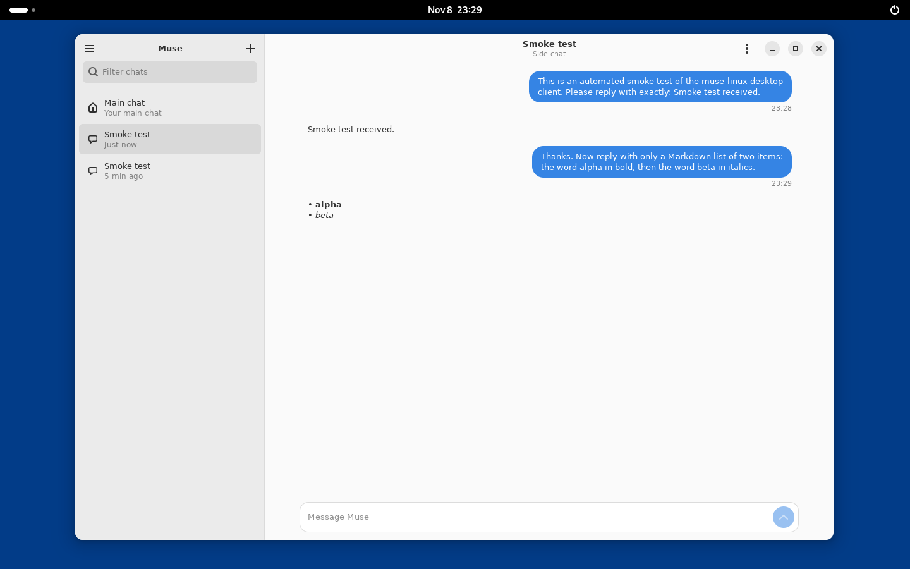
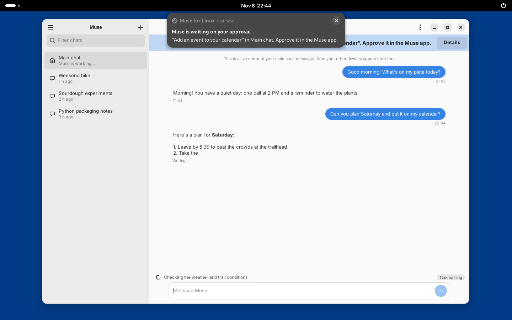
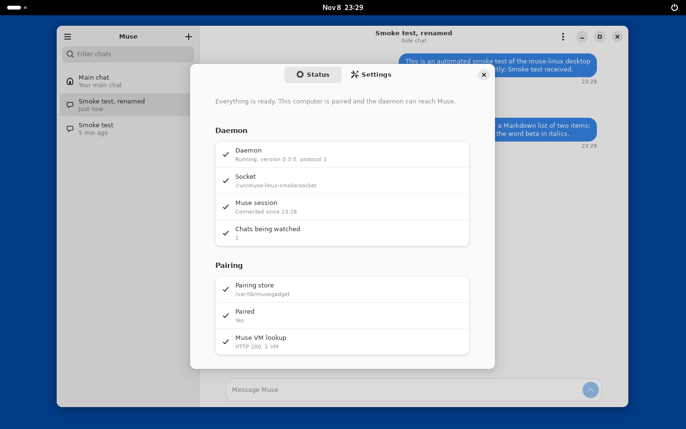
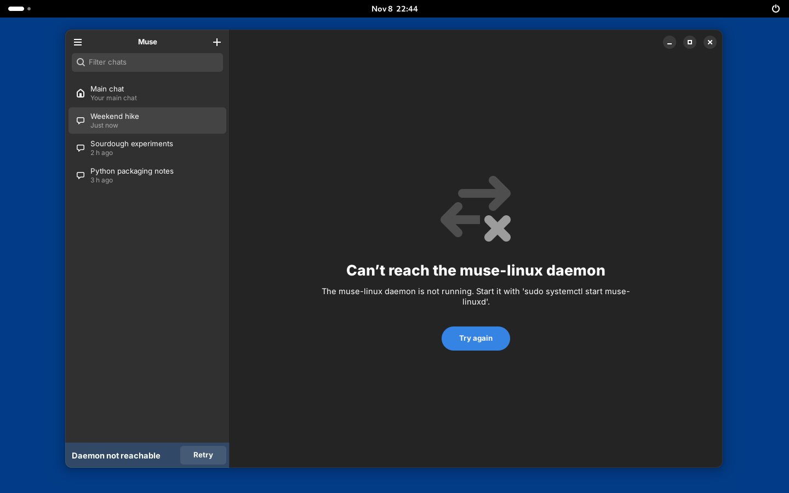
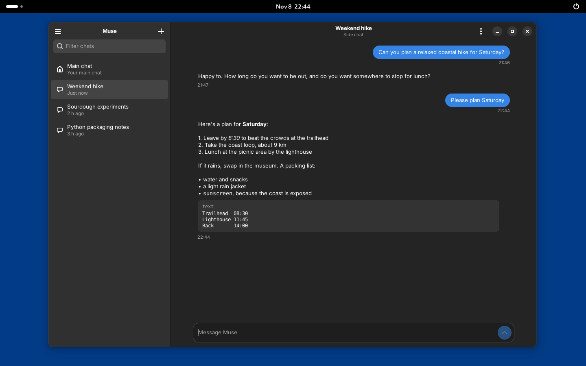
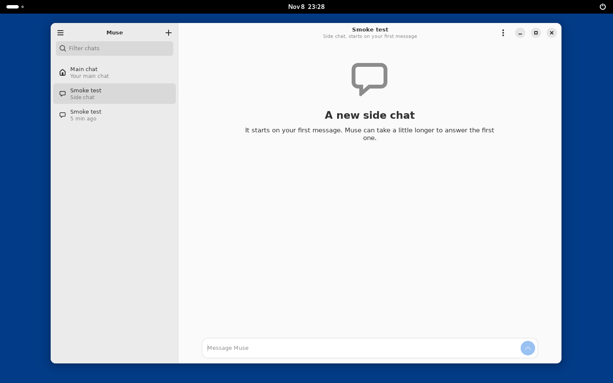
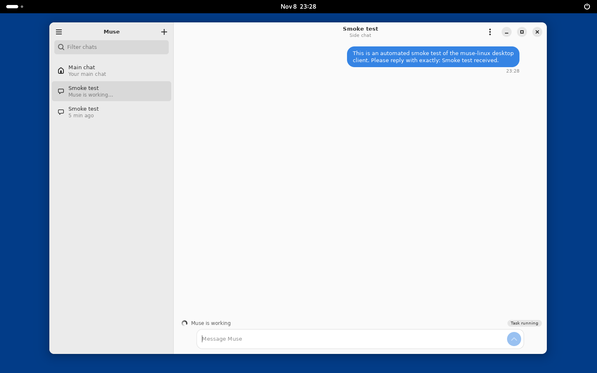
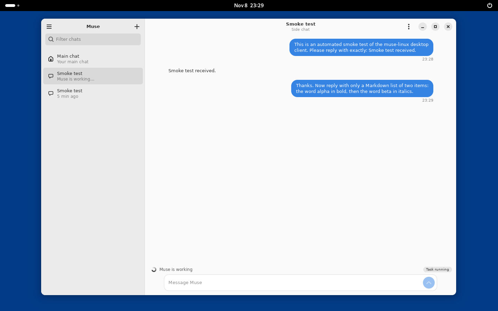
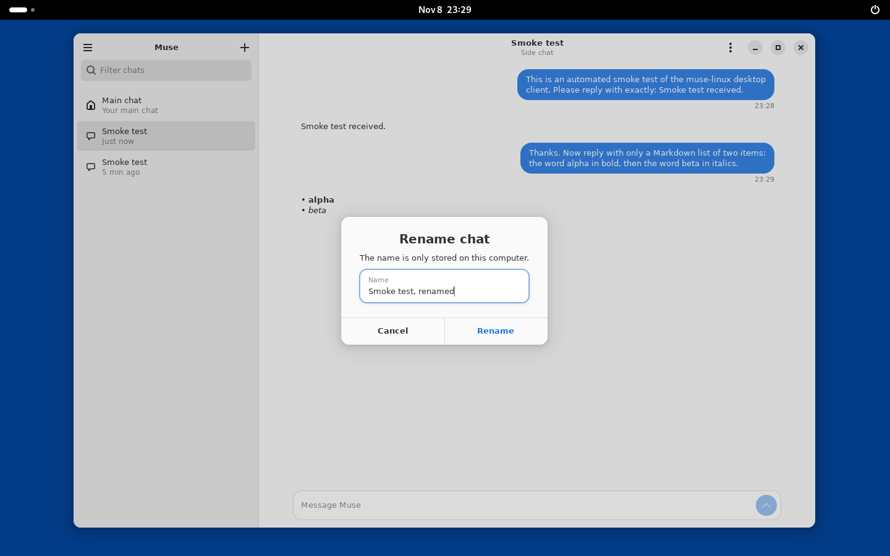

# Muse for Linux on GNOME

`muse-linux-gnome` is the GNOME desktop client: GTK 4 and libadwaita,
so it follows the system's light or dark style, accent color, fonts
and scaling like any GNOME app. It is a thin front end over the
[daemon](DAEMON.md): it never holds a credential, and everything it
shows comes from the daemon's socket.

## Requirements

- GTK 4.14+ and libadwaita 1.5+ with GObject introspection for Python
  (Ubuntu 24.04+, Debian 13+, Fedora 40+). Packages: `python3-gi
  gir1.2-gtk-4.0 gir1.2-adw-1` on Ubuntu/Debian; `python3-gobject
  gtk4 libadwaita` on Fedora.
- The daemon installed and running, and your user in the `muse-linux`
  group. `sudo ./install.sh` does both (see the README).

Open it from the app grid ("Muse for Linux") or run
`muse-linux-gnome`. Options: `--chat <id>` opens a chat directly,
`--socket <path>` uses another daemon socket.

## What it does

**Chat list.** The main chat is pinned on top, then side chats, most
recent activity first. Muse does not let a paired device list your
chats, so the list is this computer's index: chats you created here,
plus chats you add by ID (copy a side chat's ID from the phone or Mac
app, then use + > Add chat by ID). A dot marks a chat with a reply you
have not seen. Ctrl+K filters the list.

**Chat view.** Opening a chat loads its recent history (50 messages
by default, up to 200, which is Muse's limit; "Load older messages"
fetches more up to that limit). Replies stream in place and render
Markdown: bold, italics, inline code and code blocks, lists, quotes,
headings and links. While Muse works, a line above the message box
shows what it is doing ("Muse is working") and the task state.

**The main chat is a live mirror.** Muse's main chat replies do not say
which message they answer, so the view shows the chat as it happens,
including messages sent from your phone or Mac at the same time. It
never claims a reply answers a particular message of yours.

**Side chats.** + > New side chat (Ctrl+N) creates one; it starts on
your first message, and Muse takes a little longer to answer that
first one. Rename (F2) and Remove from list only change this
computer's index; the chat itself stays in Muse.

**Approvals are view-only.** When Muse is waiting on an approval, a
banner says what for and a notification appears. Approvals can only be
decided in the Muse app: this device's credential is refused every
approval route, so the client offers no buttons that would pretend to.

**Notifications.** A finished reply in a chat you are not looking at,
and any new approval, raise a desktop notification; clicking it opens
the chat. A chat you sent a message to stays watched after you switch
away, so its reply can still reach you. Settings > "Keep running when
the window is closed" keeps the app alive in the background for that.

**Status and settings** (Ctrl+comma). The Status page checks the
daemon, the Muse session, the pairing and the VM lookup, and says in
one sentence what is wrong and how to fix it. Settings has
notifications, background running, and how many messages to load.

When the daemon is not reachable, the window says so with the fix and
reconnects by itself when the daemon comes back, reloading the open
chat so nothing that arrived in between is missed.

Dark style follows the system:

## Keyboard

| Keys | Action |
|---|---|
| Enter | Send |
| Shift+Enter | New line |
| Ctrl+N | New side chat |
| Ctrl+Shift+N | Add a chat by ID |
| Ctrl+K or Ctrl+F | Filter chats |
| Ctrl+L | Focus the message box |
| F2 | Rename the chat |
| Ctrl+R or F5 | Reload history |
| Ctrl+comma | Status and settings |
| Ctrl+? | All shortcuts |
| Ctrl+Q | Quit |

## Known limits

- No server-side chat list (see above), and history stops at the
  newest 200 messages of a chat.
- Approvals cannot be decided from Linux.
- Not yet: image attachments, voice notes and read-aloud, calls,
  find in history. They are later phases of the plan; the web GUI and
  the CLI already have voice notes and read-aloud.
- Settings are stored per user in `~/.config/muse-linux/gnome.json`.

## Screens from the live smoke test

These come from the recorded smoke test against the real Muse
service (see [SMOKE-TEST.md](SMOKE-TEST.md)); the "demo" screenshots
above use the offline demo daemon and made-up chats.

| | |
|---|---|
|  |  |
|  |  |
